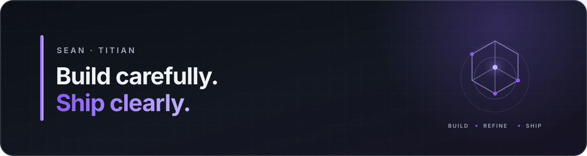

  

  <a href="https://github.com/Sean-Titian?tab=repositories">Projects</a>
  ·
  <a href="https://github.com/Sean-Titian?tab=stars">Learning shelf</a>
  ·
  <a href="https://www.linkedin.com/in/zishen-tian-a14318320/">LinkedIn</a>

## Hello, I'm Sean (Zishen) Tian.

I am building toward **Applied / Product Data Science with strong ML Engineering skills**.
My projects ask who to prioritize, what to test, and when the evidence is not enough to ship.

I am pursuing an M.S. in Spatial Economics and Data Analysis at the University of Southern
California (expected 2027), bringing an econometrics lens to product experimentation and applied
machine learning.

### Selected work

These are educational case studies, not client engagements. Private teaching material and
restricted raw data stay out of the repositories; synthetic evidence is labelled explicitly.

<!-- PROFILE:PROJECTS:START -->

#### [Conversion Intelligence](https://github.com/Sean-Titian/conversion-intelligence)

A decision-time audit of conversion scoring, with synthetic SQL/PySpark features, a separate
batch-capacity rule, and an assignment-origin experiment handoff. The higher-scoring final-page
model is retrospective, not a deployment result. Missing user IDs and timestamps limit source-data
generalization; the planning calculator uses assumptions, not an observed seven-day user baseline
or evidence of causal impact.

[Results and limitations](https://github.com/Sean-Titian/conversion-intelligence#reality-audited-results)
· [Experiment handoff](https://github.com/Sean-Titian/conversion-intelligence/blob/main/docs/experiment-design.md)

#### [Lifecycle Email Experimentation](https://github.com/Sean-Titian/lifecycle-email-experimentation)

A messaging case study separating limited retrospective evidence from an executable synthetic
experiment rehearsal: fixed-window ITT, multiplicity-aware inference, customer-harm guardrails,
and repeated-simulation checks. The synthetic decision remains `continue_testing`: primary
evidence and rare-event guardrails do not justify rollout. Retrospective campaign associations
remain non-causal; simulation diagnostics are not real campaign effects.

[Prospective study](https://github.com/Sean-Titian/lifecycle-email-experimentation/blob/main/docs/prospective-synthetic-study.md)
· [Evidence and limitations](https://github.com/Sean-Titian/lifecycle-email-experimentation/blob/main/docs/evidence-card.md)

#### [Review Sentiment Reliability](https://github.com/Sean-Titian/review-sentiment-reliability)

A synthetic-only reliability harness for review-text triage, with duplicate-aware, grouped,
temporal, negative-control, and capacity checks. Its character-trigram duplicate candidate failed
the adoption gate and was rejected; it did not replace the current equality-based split. The
rating-derived target may be redundant when ratings are visible, and real operational value
remains unvalidated. No real-review performance is claimed.

[Decision contract](https://github.com/Sean-Titian/review-sentiment-reliability#decision-contract)
· [Rejected-candidate report](https://github.com/Sean-Titian/review-sentiment-reliability/blob/main/reports/fuzzy-duplicate-benchmark.json)

<!-- PROFILE:PROJECTS:END -->

### How I work

Define the action, unit, timing, and cost of error. Check leakage, baselines, uncertainty, and
failure modes before optimizing a score. Keep prediction separate from intervention claims,
and make code reproducible with tests, CI, and explicit limitations.

### T-shaped direction

- **Developing depth:** experimentation, causal inference, and applied ML.
- **Demonstrated project breadth:** Python, SQL/PySpark, reproducible ML pipelines, testing, and CI.
- **Building next:** broader MLOps, cloud, and LLM systems when a project needs them—not as claims
  of current proficiency. Longer-term interest: Applied Scientist / ML Scientist.

### Evidence shipped, learning next

The linked projects contain the detailed benchmarks, uncertainty, rejected approaches, and
reproduction instructions. I am prioritizing better evidence before more infrastructure:
matched user-level baselines and complete outcome windows for experiments; independently labelled,
operationally useful review targets with clear reuse rights; and human-adjudicated duplicate
evidence before scaling a detector. No real-world performance claim will replace these gaps.

  Measure carefully · Build responsibly · Improve in public

