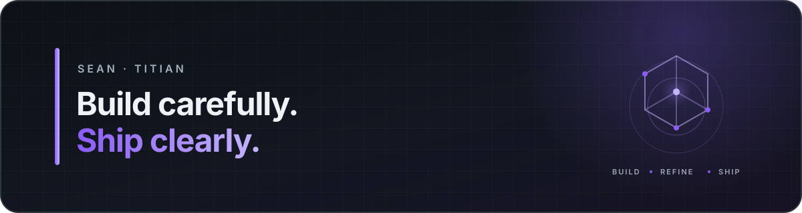

  

  <a href="https://github.com/Sean-Titian?tab=repositories">Projects</a>
  ·
  <a href="https://github.com/Sean-Titian?tab=stars">Learning shelf</a>
  ·
  <a href="https://www.linkedin.com/in/zishen-tian-a14318320/">LinkedIn</a>

## Hello, I'm Sean (Zishen) Tian.

I am building toward **Applied / Product Data Science with strong ML Engineering skills**. I care about the full path from a product question to a trustworthy decision: define the metric, validate the data, model the uncertainty, test the intervention, and ship a reproducible system.

I am pursuing an M.S. in Spatial Economics and Data Analysis at the University of Southern
California (expected 2027), bringing an econometrics lens to product experimentation and applied
machine learning.

### Selected work

Each case study is rebuilt from my own analysis and excludes private course material, restricted
data, and unverifiable claims. Projects are linked only after passing a reality, license,
reproducibility, and documentation review.

<!-- PROFILE:PROJECTS:START -->
- **[Conversion Intelligence](https://github.com/Sean-Titian/conversion-intelligence)** — acquisition scoring with a prediction-time contract: mean AP 0.133 against a 3.2% base rate and 5.25× lift at the top 5%. A synthetic-only Spark SQL/PySpark extension enforces event- and availability-time cutoffs and one row per score request, with exact Spark/Pandas parity on its deterministic fixture. Package 0.2.1 additionally preflights raw CSV headers and embeds one fail-closed feature projector across fit, direct prediction, and in-memory serialization reload; duplicate schemas and invalid known numeric domains are rejected without changing any reported metric or estimator algorithm. The higher-scoring full-session model remains a retrospective upper bound because its final page count is unavailable at the acquisition-time decision.
- **[Lifecycle Email Experimentation](https://github.com/Sean-Titian/lifecycle-email-experimentation)** — a messaging case study that separates a limited retrospective source audit from a public-safe prospective rehearsal. Package 0.5.0 retains six content-by-cadence cells, a concurrent holdout, 10 fail-closed integrity gates, and block-standardized primary inference. The pre-specified synthetic candidate remains +1.50 pp versus holdout (block-standardized nominal, non-simultaneous 95% CI -0.10 to +3.10 pp; Holm-adjusted p = 0.395). Rare-event guardrails remain pooled Newcombe-style bounds with 12-way Bonferroni control and are explicitly not block-adjusted. A new five-scenario diagnostic runs 20,000 replications per scenario: the 2.7839 pp analytic value is explicitly a first-order planning reference, and its empirical Holm superiority probability is 65.8% (99% Monte Carlo CI 64.9% to 66.6%), not an attained 80%-power MDE. Even when the synthetic candidate has an eight-percentage-point funding risk difference versus holdout and true complaint and unsubscribe risk differences of zero, the complete decision rule passes only 0.10% of replications (99% Monte Carlo CI 0.057% to 0.176%) because rare-event guardrail bounds remain imprecise. The single-run canonical decision remains `continue_testing`; separately, all frozen method-calibration gates pass while the operating-characteristics design-readiness status also remains `continue_testing`. These synthetic checks do not estimate a real campaign effect or authorize rollout. In the retrospective source snapshot, only 1 of 24 exploratory funding differences survived correction (+0.311 pp; adjusted p ≈ 0.011); this association remains non-causal, and no cadence winner was supported.
- **[Review Sentiment Reliability](https://github.com/Sean-Titian/review-sentiment-reliability)** — a synthetic-only Applied/Product DS case study on whether text available at submission time could prioritize a limited manual-review queue. Package 0.7.0 / Contract 5.2 pre-specifies 5%, 10%, and 20% capacities, stress-tests repeated content and entities, chronology, authored label delay, calibration, negative controls, and serving shifts, then adds 20,000 common token-set-equality fingerprint-cluster resamples. Its nominal 95% Bonferroni lift-family bands include chance at 5% and 10%; the 20% band is 1.29×–2.37× for one frozen synthetic scoring rule. This demonstrates a reproducible evaluation harness—not pairwise capacity differences, an optimal queue, causal or operational validity, staffing guidance, business value, or real-world performance—and the rating-derived weak target may be redundant when ratings are visible.
<!-- PROFILE:PROJECTS:END -->

### How I work

| Frame the decision | Separate prediction from causality | Build for review |
| :--- | :--- | :--- |
| Start with the user, metric, prediction time, and cost of error. | Use observational models for ranking; use experiments for intervention claims. | Add data contracts, tests, CI, model cards, and honest limitations. |

### T-shaped direction

| Depth I am developing | Breadth I am building | Long-term direction |
| :--- | :--- | :--- |
| Experimentation · Causal inference · Applied ML | SQL · PySpark · MLOps · Cloud · LLM systems | Applied / Product Data Scientist → Applied Scientist / ML Scientist |

I treat this as a roadmap, not a wall of skill badges. A technology appears as a demonstrated strength only after a project makes the design choices, limitations, and evidence visible.

### Evidence shipped, learning next

SQL/PySpark has moved from roadmap to public project evidence through the Conversion pipeline above and its dedicated Spark parity CI. Package 0.2.1 adds controlled schema/preprocessing consistency checks across ingestion, fit, direct scoring, in-memory reload, and point-in-time output; its release CI passes Python 3.11–3.13 plus Java 17/PySpark parity. The tracked benchmarks and reported metrics are unchanged. Together these demonstrate transformation and model-input contract integrity—not production scale, online freshness, cross-language serving parity, or improved real-world model performance.

Experimentation design and decision engineering have also moved from roadmap to public evidence through Lifecycle Email's executable prospective harness. Package 0.5.0 keeps 10 named, fail-closed assignment, timing, contamination, negative-control, and ITT gates, then adds a deterministic count-level operating-characteristics study with five frozen scenarios, 20,000 replications per scenario, and two-sided 99% Wilson Monte Carlo intervals. It checks null primary and negative-control family-wise error, interval coverage, false guardrail non-inferiority at the margins, invalid-replicate handling, and 12 fixed parity checks against the row-level production API. The calibration gates pass, while the planning-reference scenario reaches only 65.8% empirical Holm superiority. In the separate scenario with a candidate-versus-holdout funding risk difference of eight percentage points and true complaint and unsubscribe risk differences of zero, the complete decision rule passes only 0.10% of replications. In that strong-effect scenario, rare-event guardrail precision—not primary-effect detection—is the binding constraint. The design therefore remains `continue_testing`. A real deployment still needs reconciliation to frozen eligibility and randomization records plus independent source watermarks or complete participant-level endpoint snapshots; passing a synthetic calibration study does not validate a campaign effect or real-world rollout probability.

Review reliability has moved from roadmap to public evidence through a reproducible, synthetic-only decision audit. The prediction-time contract admits only summary and body text and requires split, recurrence, forward-time, label-delay, baseline, calibration, label-shuffle/placebo, and serving-stress gates before an aggregate report can be written. Package 0.7.0 / Contract 5.2 applies the same 20,000 one-way pairs cluster-bootstrap resamples of token-set-equality fingerprint clusters at pre-specified 5%, 10%, and 20% queue shares and limits nominal simultaneous coverage to lift across that three-member family: [0.23×, 2.34×], [0.75×, 2.32×], and [1.29×, 2.37×]. A pinned Python 3.13.9 CI job rebuilds the aggregate report and requires a byte-for-byte match. These are nominal, conditional intervals for one frozen fitted scoring rule, split manifest, and authored synthetic test fixture—not finite-sample guarantees. They do not cover retraining or threshold selection, crossed user/product dependence, generator or source uncertainty, or future drift; they neither estimate pairwise capacity differences nor establish capacity optimality, staffing, business value, causal impact, operational validity, or real-world generalization.

Next I am replacing synthetic assumptions with evidence: obtain an independently labeled operational target that remains useful when ratings are visible, with an observed outcome window and `label_available_at`; resolve direct provenance and reuse rights; and scale near-duplicate validation with measured false-merge risk. Time-block uncertainty and prior-drift tests follow once that target and its maturity process exist. No real-data performance claim will be promoted until those gates pass.

  Measure carefully · Build responsibly · Improve in public

